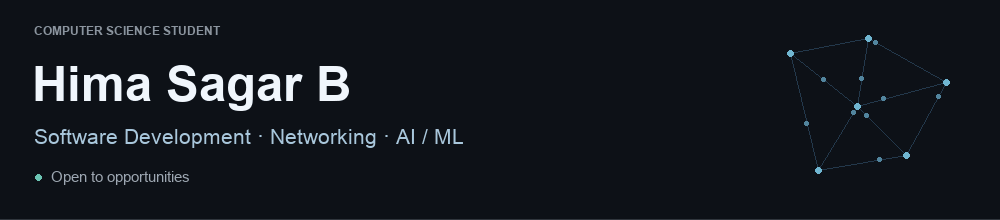
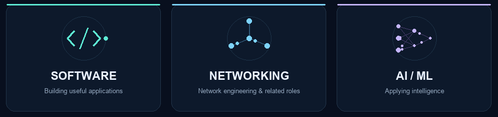
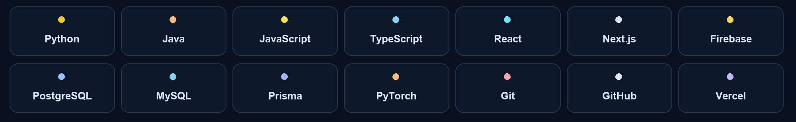
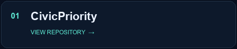
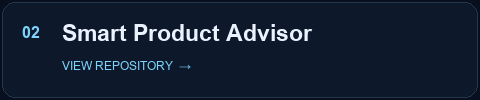
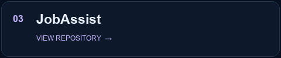
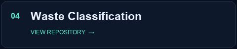

 

  

### Curious about how things work. Driven to build what comes next.

I'm **Hima Sagar B**, a **Computer Science student** exploring the intersection of 
**software development, networking, and applied AI.**

I enjoy turning ideas into useful applications, solving problems, 
and understanding the systems beneath the surface.

**Currently sharpening:** Data Structures & Algorithms · System Design Fundamentals · Networking

 

 

### My toolkit

From interfaces and databases to models and deployment.

  

### A few things I've built & worked on

A quick look at my work. The details live in the repositories.

  

 

JobAssist is adapted from Dossier; [contributions & credits](https://github.com/HimaSagarB/JobAssist/blob/main/ATTRIBUTION.md).

  

 

[**Let's connect on LinkedIn ↗**](https://www.linkedin.com/in/himasagarb/)

