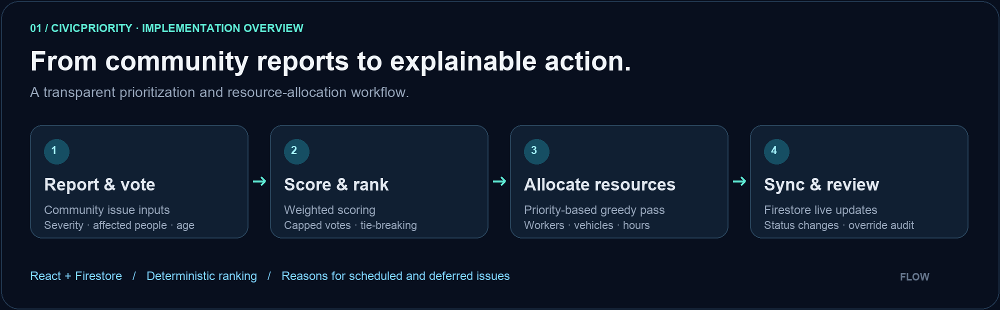
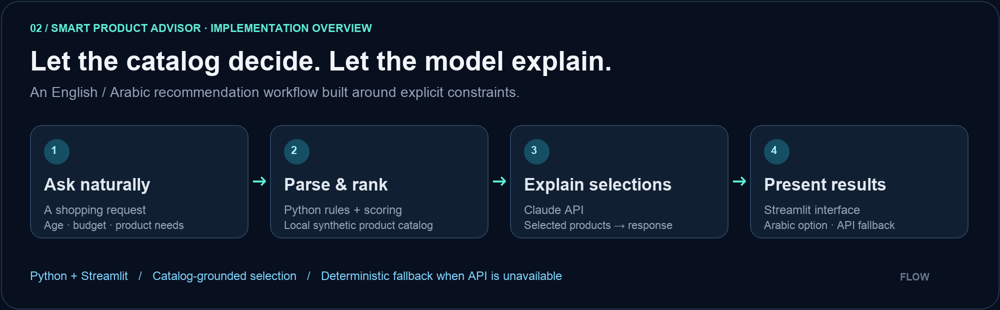
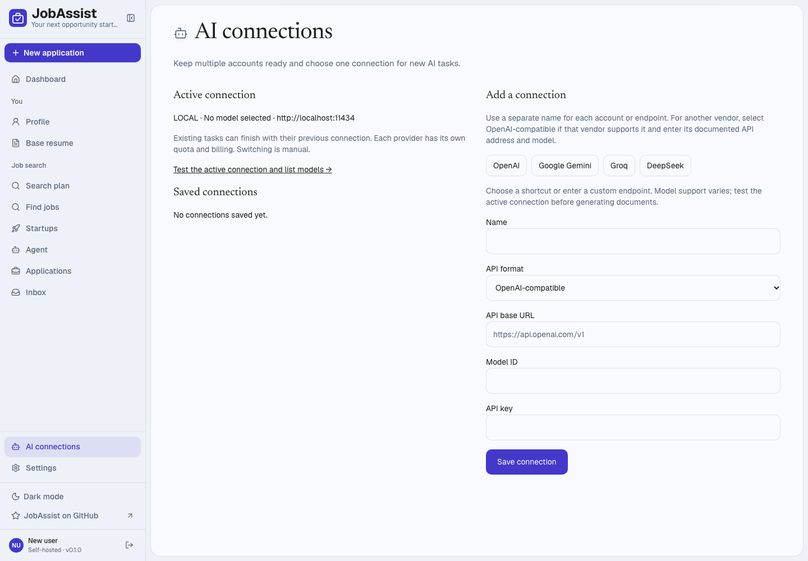

# Turning complex problems into practical software.

**Computer Science student · Full-stack development · Applied machine learning**

Real-time applications. Explainable decisions. AI with useful guardrails.

[**Connect on LinkedIn**](https://www.linkedin.com/in/himasagarb/) &nbsp; · &nbsp; [**Explore my projects**](https://github.com/HimaSagarB?tab=repositories) &nbsp; · &nbsp; [**Try CivicPriority ↗**](https://himasgrcommprioapp.vercel.app/)

**Open to opportunities in software development / SDE, network engineering, and AI / ML.**

[About](#about-me) · [Selected work](#selected-work) · [Skills](#technical-toolkit) · [Focus](#what-im-building-toward) · [Connect](#lets-connect)

## About me

I'm **Hima Sagar B**, a Computer Science student interested in how applications, intelligent models, and connected systems work together. I build projects that turn messy inputs into useful decisions: prioritizing community issues, matching products to specific needs, and making job-search workflows easier to manage.

My interests span **software engineering, computer networking, and applied AI / ML**. In my projects, I focus on the decisions behind the interface: how data stays in sync, how a ranking can be explained, and what happens when an external service is unavailable.

- **Build:** full-stack applications with React, JavaScript / TypeScript, Python, and databases.
- **Apply:** machine learning and language models to recommendation, classification, and text analysis.
- **Strengthen:** data structures and algorithms, system design fundamentals, networking, and cloud concepts.

## Selected work

### 01 · CivicPriority

**Community issues, ranked by impact. Limited resources, allocated with a reason.**

A React and Firebase application for reporting community issues, voting, tracking resolution, and scheduling available resources.

Implementation overview based on the project documentation.

- Ranks issues using severity, people affected, time pending, and location sensitivity, with capped voting influence and deterministic tie-breaking.
- Uses a greedy allocation algorithm to schedule issues against worker, vehicle, and time constraints, recording why others are deferred.
- Keeps clients synchronized through Firestore listeners and includes role-specific workflows and an admin override audit trail.

**Engineering focus:** explainable ranking · resource constraints · real-time state

`React` `JavaScript` `Firebase Firestore` `Vite`

[Explore the code](https://github.com/HimaSagarB/Software_Community-PrioApp) · [Open the demo](https://himasgrcommprioapp.vercel.app/)

### 02 · Smart Product Advisor

**Natural-language requests → catalog-based recommendations → clear explanations.**

An English / Arabic product advisor built around a synthetic baby-care catalog, combining explicit constraints with language-model-generated explanations.

Implementation overview: catalog selection and response generation are separate stages.

- Extracts age, budget, and other shopping constraints from a query, then ranks catalog products using deterministic Python logic.
- Passes selected products to Claude for personalized explanations, separating catalog selection from response generation.
- Provides a Streamlit interface, Arabic translation, and a deterministic fallback when the API is unavailable or unconfigured.

**Engineering focus:** constraint handling · grounded generation · graceful fallbacks

`Python` `Streamlit` `Claude API` `JSON`

[Explore the code and architecture](https://github.com/HimaSagarB/AI_ProductsReccomendation)

### 03 · JobAssist

**A personal workspace for a more organized job search.**

A customized job-search application adapted from [AienTech's Dossier](https://github.com/AienTech/dossier), with project-specific work documented in [the attribution notes](https://github.com/HimaSagarB/JobAssist/blob/main/ATTRIBUTION.md).

Actual interface screenshot from the JobAssist repository. Click to explore the project.

- Added search-plan preferences and filters integrated with the daily drafting workflow.
- Added multiple named AI connections, encrypted credential storage, explicit activation, and provider shortcuts.
- Added persistent local PostgreSQL setup and startup tooling, refreshed the interface, and documented local workflow verification.

**Engineering focus:** extending an existing codebase · provider configuration · local developer experience

`TypeScript` `Next.js` `Prisma` `PostgreSQL`

[Explore the project](https://github.com/HimaSagarB/JobAssist) · [Review contributions](https://github.com/HimaSagarB/JobAssist/blob/main/ATTRIBUTION.md)

### 04 · Waste Classification

**Computer vision applied to everyday waste sorting.**

A collection of notebooks exploring YOLO-based waste classification, alongside a Streamlit image-upload interface.

- Includes experiments involving YOLOv8, YOLOv11, ResNet, and Swin variants.
- The interface loads a trained YOLO model and displays a biodegradable / non-biodegradable result with prediction confidence.
- Connects notebook experimentation with an interactive inference workflow.

**Engineering focus:** model experimentation · image inference · usable ML interfaces

`Python` `PyTorch` `Ultralytics YOLO` `Streamlit` `Jupyter`

[Explore the notebooks and interface](https://github.com/HimaSagarB/NNDL_Waste-Classification)

<b>Also exploring: emotion analysis with EmoSense</b>

My [EmoSense repository](https://github.com/HimaSagarB/EmoSense) is a fork of [Krish6115/EmoSense](https://github.com/Krish6115/EmoSense). The upstream project combines RoBERTa-based emotion classification, emotion intensity, and sarcasm detection with a FastAPI backend and Streamlit interface.

It reflects my interest in applied NLP and model-serving workflows. Original project credit belongs to the upstream authors.

## Technical toolkit

| Area | Technologies and practice |
| :--- | :--- |
| **Languages** | Python · Java · JavaScript · TypeScript |
| **Application development** | React · Next.js · Streamlit · Vite |
| **Data and persistence** | Firebase Firestore · PostgreSQL · MySQL · Prisma |
| **AI / ML** | PyTorch · Ultralytics YOLO · Jupyter · LLM API integration · rule-based recommendation |
| **Tools and delivery** | Git · GitHub · Vercel · local application setup |

## What I'm building toward

| Direction | Current focus |
| :--- | :--- |
| **Software development / SDE** | Data structures and algorithms, system design fundamentals, maintainable applications, and dependable data flows. |
| **Network engineering** | Deepening computer networking and cloud fundamentals, with an interest in how connected services communicate and stay available. |
| **AI / ML engineering** | Moving from experiments to usable interfaces, with attention to constraints, model behavior, and fallback paths. |

<b>Explore my recent GitHub activity</b>

## Let's connect

I'm interested in opportunities across **software development, network engineering, and AI / ML**, and in conversations about practical systems that solve real problems.

**Recruiters and collaborators:** reach me on [LinkedIn](https://www.linkedin.com/in/himasagarb/). My [repositories](https://github.com/HimaSagarB?tab=repositories) include source code, implementation notes, and project documentation.

**Useful software starts with understanding the problem.**

<a href="https://www.linkedin.com/in/himasagarb/">LinkedIn</a> · <a href="https://github.com/HimaSagarB?tab=repositories">GitHub projects</a> · <a href="https://himasgrcommprioapp.vercel.app/">CivicPriority demo</a>

